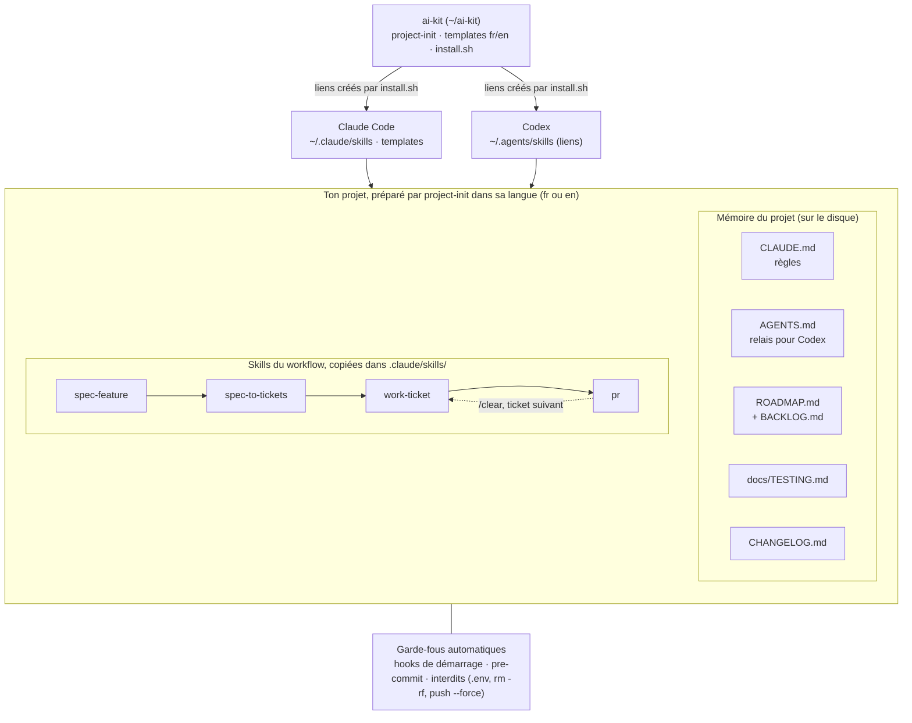
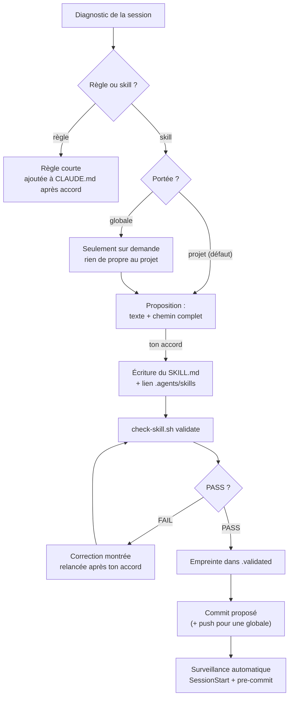

# Guide d'AI Kit v3 — vue d'ensemble et dictionnaire

[English](GUIDE.md) · **Français**

Ce guide sert à comprendre le kit. Aucun agent ne le lit pendant les sessions : il ne coûte aucun token.
Pour l'installation et l'usage au quotidien, voir le [README](README.fr.md).

## 1. Vue d'ensemble

Quatre idées à retenir :
- **Le kit est la seule source** : on ne modifie qu'à un endroit, `~/ai-kit`. Claude et Codex voient la même skill globale (`project-init`) grâce aux liens.
- **Le projet a ses propres skills, dans sa langue** : `project-init` y copie les 5 skills du workflow en français ou en anglais, avec le script de vérification. Le projet fonctionne ainsi même sur une machine où le kit n'est pas installé.
- **Le projet porte la mémoire** : `CLAUDE.md`, `ROADMAP.md`, `BACKLOG.md`, `docs/TESTING.md` et `CHANGELOG.md` gardent l'avancement sur le disque. C'est ce qui permet le `/clear` entre deux tickets sans rien perdre.
- **Les garde-fous ne dépendent pas des agents** : hooks, `pre-commit` et interdictions s'appliquent même si un agent oublie une consigne.

## 2. Dictionnaire

### Les agents et leurs fichiers de règles

| Terme | Définition |
| --- | --- |
| Agent | Programme d'IA qui travaille dans ton projet : lit, écrit des fichiers, lance des commandes. Ici : Claude Code et Codex. |
| Claude Code | L'agent d'Anthropic, en terminal (`claude`) ou dans l'extension VS Code. |
| Codex | L'agent d'OpenAI, en terminal (`codex`), extension ou application. |
| `CLAUDE.md` | Règles du projet, à la racine. Claude le lit au début de chaque session. Budget : 150 lignes. |
| `AGENTS.md` | Fichier lu par Codex : renvoie vers `CLAUDE.md`, interdit la lecture de `.env` et demande de signaler toute commande refusée. |
| Session | Une conversation avec un agent, de son lancement à sa fermeture ou à `/clear`. |
| `/clear` | Vide la conversation. Lancé entre deux tickets : chaque ticket repart d'un contexte vide, ce qui évite de payer l'historique des tickets précédents. |
| Token | Unité de texte facturée au modèle. Tout ce que l'agent lit ou écrit consomme des tokens. |

### Les skills

| Terme | Définition |
| --- | --- |
| Skill | Dossier contenant un `SKILL.md` : une procédure que l'agent suit quand on l'appelle. |
| Skill globale du kit | `project-init`, la seule installée pour tous les projets. Bilingue : elle demande la langue avant tout. |
| Skills du workflow | `spec-feature`, `spec-to-tickets`, `work-ticket`, `pr`, `learn-skill`. Rangées dans `templates/fr/skills/` et `templates/en/skills/`, copiées dans chaque projet dans sa langue. |
| Langue du projet | `fr` ou `en`, choisie au début de `project-init`. Elle décide de la langue de tous les fichiers du projet, skills comprises. |
| Langue des réponses | `fr` ou `en`, choisie juste après (par défaut, la même). Langue des réponses et des comptes rendus de l'agent, enregistrée dans `CLAUDE.md`. |
| `SKILL.md` | Le fichier de la skill : un frontmatter, puis les instructions. Budget : 80 lignes. |
| Frontmatter | Le bloc entre deux lignes `---` en haut du fichier : `name`, `description`… |
| `name` | Nom de la skill, identique au nom du dossier. C'est le mot tapé après `/` ou `$`. |
| `description` | Phrase qui dit quand utiliser la skill. Toujours chargée, c'est elle que l'agent lit pour choisir. |
| `disable-model-invocation` | Réglage Claude Code : la skill ne se lance que si tu l'appelles. Codex l'ignore, d'où la mention « seulement quand l'utilisateur le demande » dans chaque description. |
| `` `/nom` `` / `` `$nom` `` | Appeler une skill dans Claude Code / dans Codex. Dans un `SKILL.md`, un appel s'écrit toujours entre backticks ; un `/nom` sans backticks est un chemin de dossier. |
| Portée projet | Skill rangée dans `.claude/skills/` du projet, avec un lien Codex dans `.agents/skills/`. Choix par défaut, et celle des skills du workflow. |
| Portée globale | Skill rangée dans `~/ai-kit/skills/`, avec un lien dans `~/.claude/skills/` et un dans `~/.agents/skills/`. Seulement sur demande, et si elle ne cite rien de propre à un projet. À nom égal, une skill globale l'emporte sur une skill projet. |
| Parité | Une skill qui cite un élément propre à un agent donne aussi l'équivalent de l'autre (`/nom` ↔ `$nom`, `.claude/skills` ↔ `.agents/skills`…). |

### Les fichiers et outils du système

| Terme | Définition |
| --- | --- |
| `~` | Ton dossier personnel (ex. `/home/driss`). `~/.claude` concerne tous tes projets. |
| Lien symbolique | Raccourci vers un autre fichier ou dossier (`ln -s`). Lire le lien revient à lire la cible. |
| Lien orphelin | Lien dont la cible n'existe plus (skill supprimée ou renommée). `install.sh` retire ceux qui pointent vers le kit. |
| `install.sh` | Script lancé à l'installation, puis si tu déplaces le kit ou ajoutes une skill globale à la main : lie `~/.claude/templates` au kit et ajoute un lien par skill globale du kit dans `~/.claude/skills/` et `~/.agents/skills/`, sans toucher à tes autres skills. `./install.sh --uninstall` les retire. |
| `~/.ai-kit-backup/` | Sauvegardes faites par `install.sh` avant de remplacer un dossier existant, rangées par date, hors des dossiers lus par les agents. |
| Hook | Commande lancée automatiquement à un moment précis (début de session, commit…). |
| `SessionStart` | Hook lancé au début d'une session (Claude et Codex). Il vérifie les skills modifiées et la taille du `CLAUDE.md` ; s'il n'y a rien à signaler, il n'affiche rien. |
| `.claude/settings.json` | Réglages Claude Code du projet : permissions et hooks. |
| `.claude/settings.local.json` | Tes autorisations personnelles (« Yes, don't ask again »). Ajouté au `.gitignore` pour ne jamais être commité. |
| `.codex/hooks.json` | Hooks Codex du projet. |
| `.codex/rules/default.rules` | Commandes interdites à Codex (`forbidden`). Expérimental ; ne couvre que les commandes shell à la racine, pas la lecture de fichiers. |
| Permissions `allow` / `deny` | Commandes que Claude peut lancer sans demander / qu'il ne doit pas lancer. Garde-fou, pas sécurité. |
| `.env` | Fichier de secrets. Lecture et modification interdites aux deux agents (règles Claude, règles Codex et consigne de `AGENTS.md`). `.env.example` reste accessible. |
| `pre-commit` | Hook Git lancé avant chaque commit. Il bloque si une skill n'est pas conforme. |
| `core.hooksPath` | Réglage Git qui dit où sont les hooks (ici `.githooks/`, versionné avec le projet). |
| `check-skill.sh` | Script qui vérifie les skills sans passer par le modèle. Rangé dans `templates/` du kit et copié dans chaque projet (`.claude/skills/learn-skill/scripts/`). `check` et `budget` ne modifient rien ; seul `validate` écrit. |
| Symétrie fr/en | `templates/fr/` et `templates/en/` contiennent exactement les mêmes fichiers. Le `pre-commit` du kit bloque sinon. |
| Budget de lignes | Taille maximale d'un fichier. Un dépassement donne un avertissement, jamais un blocage. |
| Empreinte (`sha256`) | Code calculé à partir du contenu d'un fichier. Il change dès qu'un caractère change. |
| `.validated` | Empreintes des skills validées. Sert à repérer les skills modifiées depuis leur validation. |

### Les documents du projet

| Terme | Définition |
| --- | --- |
| Template | Modèle de fichier avec des trous à remplir, rangé dans `~/ai-kit/templates/` (versions `fr` et `en`). |
| Placeholder | Un trou dans un template, écrit `{{NOM}}`, remplacé par la vraie valeur. |
| `ROADMAP.md` | Vision, jalons (`v0.1`, `v0.2`…) et ce qui est hors périmètre. |
| `BACKLOG.md` | Tâches reportées, dette technique, idées. Seule exception à l'accord : ajouter une ligne dans « Reporté / Incomplet ». |
| `CHANGELOG.md` | Journal des changements, format Keep a Changelog. Écrit en fin de ticket, jamais lu au démarrage. |
| `Unreleased` | Section du CHANGELOG pour les changements pas encore publiés. |
| `docs/TESTING.md` | Outil de test, emplacement, nommage, commandes et format de preuve. Statut : « Existant », « Mis en place le … » ou « Non installé ». |
| Spec | Description d'une fonctionnalité avant de la coder. `docs/specs/00-setup.md` pour le socle technique, puis `01-…`, `02-…`. |
| Ticket | Petite tâche tirée d'une spec : 1 ticket = 1 branche = 1 PR (`docs/tickets/01-01-nom.md`). Il doit laisser `main` fonctionnel. |
| Critère d'acceptation | Condition vérifiable qui dit qu'un ticket est réussi (CA1, CA2…). |
| Definition of Done | Liste de ce qui doit être vrai pour dire « fini ». |
| ADR | Note qui garde une décision d'architecture et pourquoi elle a été prise. |
| Checklist Pass/Fail | Bilan de fin de travail. Chaque Pass vérifiable donne sa preuve (commande + résultat, branche, fichiers). |
| « Reports : … » | Ligne du compte rendu qui liste ce qui est remis à plus tard (ou « aucun nouveau » / « none », selon la langue des réponses). |
| Conventional Commits | Format des messages de commit : `type(scope): résumé` (ex. `feat(auth): add login`). |
| PR (Pull Request) | Demande de fusion d'une branche dans la branche principale. |

## 3. Comment les templates sont utilisés

Un template n'est jamais lancé : l'agent le recopie dans ton projet en remplaçant les `{{placeholders}}`, quand une skill le lui demande. Les templates `.md` et les skills viennent du dossier de la langue du projet (`templates/fr/` ou `templates/en/`) ; les fichiers techniques sont communs. Si le fichier existe déjà, il propose les modifications au lieu d'écraser. Modifier un template ne change que les prochains fichiers créés.

| Template | Fichier créé dans le projet | Par quelle skill | Quand |
| --- | --- | --- | --- |
| `CLAUDE.tpl.md` | `CLAUDE.md` | `project-init` | Une fois |
| `AGENTS.tpl.md` | `AGENTS.md` | `project-init` | Une fois |
| `ROADMAP.tpl.md` | `ROADMAP.md` | `project-init` | Une fois |
| `BACKLOG.tpl.md` | `BACKLOG.md` | `project-init` | Une fois |
| `CHANGELOG.tpl.md` | `CHANGELOG.md` | `project-init` | Une fois |
| `TESTING.tpl.md` | `docs/TESTING.md` | `project-init` | Une fois |
| `ADR.tpl.md` | `docs/adr/001-stack-and-architecture.md` | `project-init` | Une fois, si pertinent |
| `settings.tpl.json` | `.claude/settings.json` | `project-init` | Une fois |
| `codex-hooks.tpl.json` | `.codex/hooks.json` | `project-init` | Une fois |
| `codex-rules.tpl.rules` | `.codex/rules/default.rules` | `project-init` | Une fois |
| `pre-commit.tpl.sh` | `.githooks/pre-commit` | `project-init` | Une fois, si aucun hook Git n'existait |
| `skills/*` (de la langue choisie) | `.claude/skills/*` + liens `.agents/skills/*` | `project-init` | Une fois |
| `check-skill.sh` | `.claude/skills/learn-skill/scripts/check-skill.sh` | `project-init` | Une fois |
| `SPEC.tpl.md` | `docs/specs/NN-<slug>.md` | `spec-feature` | Pour chaque fonctionnalité |
| `TICKET.tpl.md` | `docs/tickets/NN-NN-<slug>.md` | `spec-to-tickets` | Pour chaque spec validée |
| `SKILL.tpl.md` | `.claude/skills/<nom>/SKILL.md` | `learn-skill` | Pour chaque nouvelle skill |

## 4. Comment se crée une skill

1. **Diagnostic** : l'agent relit la session et choisit le support. Une règle courte va dans `CLAUDE.md`, une procédure détaillée devient une skill.
2. **Nom et portée** : le nom doit être libre (projet, skills perso, kit, workflow). Portée projet par défaut. Globale seulement si tu la demandes et si elle ne cite rien de propre au projet ; sinon, l'agent te montre ce qu'il a trouvé.
3. **Rédaction** : dans la langue du projet, selon `SKILL.tpl.md`, avec la parité Claude / Codex et les appels entre backticks.
4. **Proposition** : texte exact et chemin complet, puis ton accord.
5. **Création et vérification** : écriture, lien Codex, puis `check-skill.sh validate`. Un FAIL est corrigé et revérifié après ton accord.
6. **Commit** : dans le projet (la skill part avec la PR en cours) ou dans le dépôt du kit pour une globale (`git -C <kit> …`), suivi d'un push si le kit a un remote.

Ensuite, la skill est surveillée sans rien à faire : le hook de début de session revérifie les skills modifiées, et le `pre-commit` bloque un commit si l'une est en FAIL.
