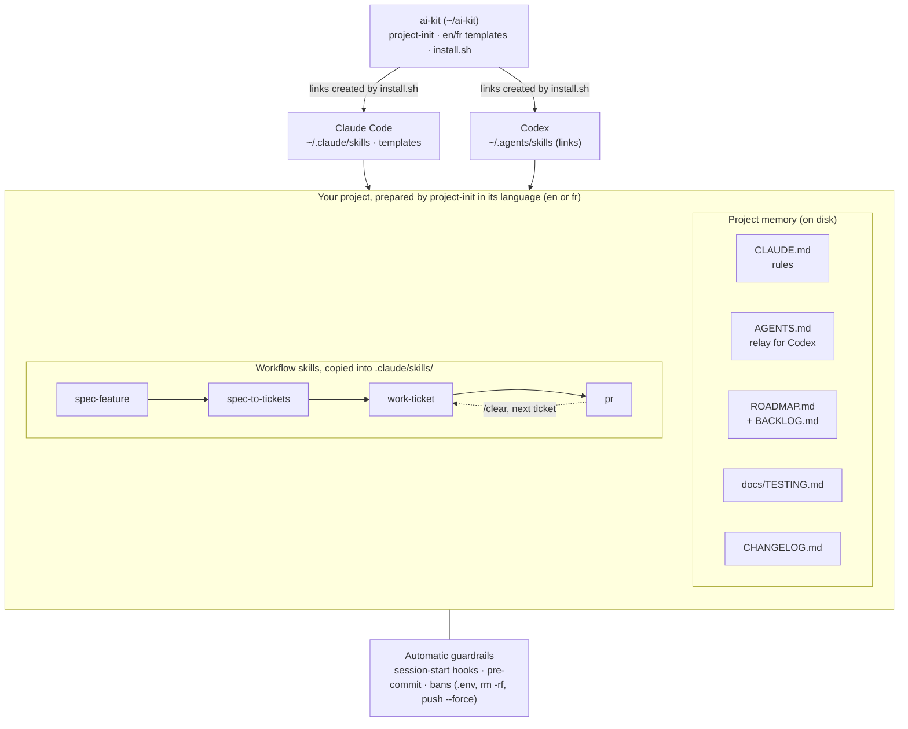
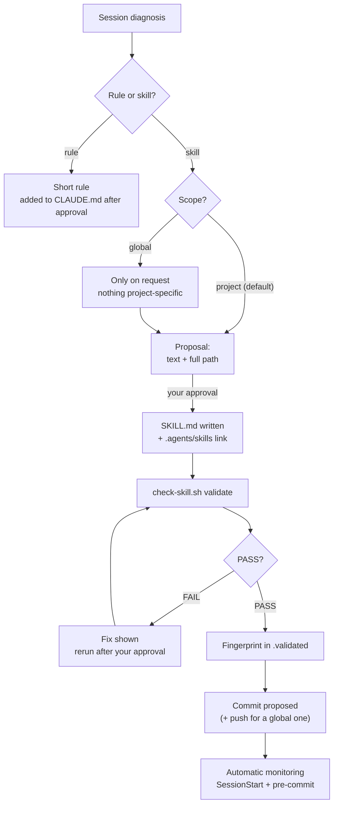

# AI Kit v3 guide — overview and glossary

**English** · [Français](GUIDE.fr.md)

This guide is for understanding the kit. No agent reads it during sessions: it costs no tokens.
For installation and day-to-day use, see the [README](README.md).

## 1. Overview

Four ideas to keep in mind:
- **The kit is the single source**: you only change things in one place, `~/ai-kit`. Claude and Codex see the same global skill (`project-init`) through links.
- **The project has its own skills, in its language**: `project-init` copies the 5 workflow skills into it, in English or French, along with the check script. The project thus works even on a machine where the kit is not installed.
- **The project holds the memory**: `CLAUDE.md`, `ROADMAP.md`, `BACKLOG.md`, `docs/TESTING.md` and `CHANGELOG.md` keep progress on disk. This is what allows `/clear` between two tickets without losing anything.
- **Guardrails do not depend on the agents**: hooks, `pre-commit` and bans apply even if an agent forgets an instruction.

## 2. Glossary

### Agents and their rules files

| Term | Definition |
| --- | --- |
| Agent | AI program working in your project: reads and writes files, runs commands. Here: Claude Code and Codex. |
| Claude Code | Anthropic's agent, in a terminal (`claude`) or in the VS Code extension. |
| Codex | OpenAI's agent, in a terminal (`codex`), extension or app. |
| `CLAUDE.md` | Project rules, at the root. Claude reads it at the start of each session. Budget: 150 lines. |
| `AGENTS.md` | File read by Codex: points to `CLAUDE.md`, forbids reading `.env` and asks to report any refused command. |
| Session | A conversation with an agent, from its launch to its closing or to `/clear`. |
| `/clear` | Empties the conversation. Run between two tickets: each ticket starts from an empty context, which avoids paying for the previous tickets' history. |
| Token | Unit of text billed by the model. Everything the agent reads or writes uses tokens. |

### Skills

| Term | Definition |
| --- | --- |
| Skill | Folder holding a `SKILL.md`: a procedure the agent follows when called. |
| Kit global skill | `project-init`, the only one installed for every project. Bilingual: it asks for the language first. |
| Workflow skills | `spec-feature`, `spec-to-tickets`, `work-ticket`, `pr`, `learn-skill`. Stored in `templates/en/skills/` and `templates/fr/skills/`, copied into each project in its language. |
| Project language | `en` or `fr`, chosen at the start of `project-init`. It decides the language of every project file, skills included. |
| `SKILL.md` | The skill file: a frontmatter, then the instructions. Budget: 80 lines. |
| Frontmatter | The block between two `---` lines at the top of the file: `name`, `description`… |
| `name` | Skill name, identical to the folder name. It is the word typed after `/` or `$`. |
| `description` | Sentence saying when to use the skill. Always loaded, it is what the agent reads to choose. |
| `disable-model-invocation` | Claude Code setting: the skill only runs when you call it. Codex ignores it, hence the "use only when the user explicitly asks" mention in each description. |
| `` `/name` `` / `` `$name` `` | Calling a skill in Claude Code / in Codex. In a `SKILL.md`, a call is always written between backticks; a `/name` without backticks is a folder path. |
| Project scope | Skill stored in the project's `.claude/skills/`, with a Codex link in `.agents/skills/`. Default choice, and the scope of the workflow skills. |
| Global scope | Skill stored in `~/ai-kit/skills/`, with one link in `~/.claude/skills/` and one in `~/.agents/skills/`. Only on request, and if it cites nothing specific to a project. With the same name, a global skill wins over a project skill. |
| Parity | A skill citing something specific to one agent also gives the other's equivalent (`/name` ↔ `$name`, `.claude/skills` ↔ `.agents/skills`…). |

### System files and tools

| Term | Definition |
| --- | --- |
| `~` | Your home folder (e.g. `/home/driss`). `~/.claude` applies to all your projects. |
| Symbolic link | Shortcut to another file or folder (`ln -s`). Reading the link means reading the target. |
| Orphan link | Link whose target no longer exists (deleted or renamed skill). `install.sh` removes those pointing to the kit. |
| `install.sh` | Script run at installation, then if you move the kit or add a global skill by hand: links `~/.claude/templates` to the kit and adds one link per global skill of the kit in `~/.claude/skills/` and `~/.agents/skills/`, without touching your other skills. `./install.sh --uninstall` removes them. |
| `~/.ai-kit-backup/` | Backups made by `install.sh` before replacing an existing folder, sorted by date, outside the folders read by the agents. |
| Hook | Command run automatically at a precise moment (session start, commit…). |
| `SessionStart` | Hook run at the start of a session (Claude and Codex). It checks modified skills and the size of `CLAUDE.md`; when there is nothing to report, it prints nothing. |
| `.claude/settings.json` | Claude Code project settings: permissions and hooks. |
| `.claude/settings.local.json` | Your personal permissions ("Yes, don't ask again"). Added to `.gitignore` so it is never committed. |
| `.codex/hooks.json` | Codex project hooks. |
| `.codex/rules/default.rules` | Commands forbidden to Codex (`forbidden`). Experimental; only covers shell commands at the root, not file reading. |
| `allow` / `deny` permissions | Commands Claude may run without asking / must not run. A guardrail, not security. |
| `.env` | Secrets file. Reading and editing are forbidden to both agents (Claude rules, Codex rules and the `AGENTS.md` instruction). `.env.example` stays accessible. |
| `pre-commit` | Git hook run before each commit. It blocks if a skill is not conformant. |
| `core.hooksPath` | Git setting saying where the hooks are (here `.githooks/`, versioned with the project). |
| `check-skill.sh` | Script that checks skills without going through the model. Stored in the kit's `templates/` and copied into each project (`.claude/skills/learn-skill/scripts/`). `check` and `budget` change nothing; only `validate` writes. |
| en/fr symmetry | `templates/en/` and `templates/fr/` hold exactly the same files. Otherwise the kit's `pre-commit` blocks. |
| Line budget | Maximum size of a file. Exceeding it gives a warning, never a block. |
| Fingerprint (`sha256`) | Code computed from a file's content. It changes as soon as one character changes. |
| `.validated` | Fingerprints of validated skills. Used to spot skills modified since their validation. |

### Project documents

| Term | Definition |
| --- | --- |
| Template | File model with blanks to fill in, stored in `~/ai-kit/templates/` (`en` and `fr` versions). |
| Placeholder | A blank in a template, written `{{NAME}}`, replaced by the real value. |
| `ROADMAP.md` | Vision, milestones (`v0.1`, `v0.2`…) and what is out of scope. |
| `BACKLOG.md` | Postponed tasks, tech debt, ideas. Only exception to approval: adding a line under "Postponed / Incomplete". |
| `CHANGELOG.md` | Change log, Keep a Changelog format. Written at the end of a ticket, never read at startup. |
| `Unreleased` | CHANGELOG section for changes not yet released. |
| `docs/TESTING.md` | Test tool, location, naming, commands and evidence format. Status: "Existing", "Set up on …" or "Not installed". |
| Spec | Description of a feature before coding it. `docs/specs/00-setup.md` for the technical base, then `01-…`, `02-…`. |
| Ticket | Small task taken from a spec: 1 ticket = 1 branch = 1 PR (`docs/tickets/01-01-name.md`). It must leave `main` working. |
| Acceptance criterion | Verifiable condition saying a ticket succeeded (AC1, AC2…). |
| Definition of Done | List of what must be true to call it "done". |
| ADR | Note recording an architecture decision and why it was made. |
| Pass/Fail checklist | End-of-work review. Each verifiable Pass gives its evidence (command + result, branch, files). |
| "Reports : …" | Line of the report listing what is postponed (or "aucun nouveau"). |
| Conventional Commits | Commit message format: `type(scope): summary` (e.g. `feat(auth): add login`). |
| PR (Pull Request) | Request to merge a branch into the main branch. |

## 3. How templates are used

A template is never run: the agent copies it into your project, replacing the `{{placeholders}}`, when a skill asks it to. The `.md` templates and the skills come from the project-language folder (`templates/en/` or `templates/fr/`); the technical files are shared. If the file already exists, the agent proposes the changes instead of overwriting. Changing a template only affects files created afterwards.

| Template | File created in the project | By which skill | When |
| --- | --- | --- | --- |
| `CLAUDE.tpl.md` | `CLAUDE.md` | `project-init` | Once |
| `AGENTS.tpl.md` | `AGENTS.md` | `project-init` | Once |
| `ROADMAP.tpl.md` | `ROADMAP.md` | `project-init` | Once |
| `BACKLOG.tpl.md` | `BACKLOG.md` | `project-init` | Once |
| `CHANGELOG.tpl.md` | `CHANGELOG.md` | `project-init` | Once |
| `TESTING.tpl.md` | `docs/TESTING.md` | `project-init` | Once |
| `ADR.tpl.md` | `docs/adr/001-stack-and-architecture.md` | `project-init` | Once, if relevant |
| `settings.tpl.json` | `.claude/settings.json` | `project-init` | Once |
| `codex-hooks.tpl.json` | `.codex/hooks.json` | `project-init` | Once |
| `codex-rules.tpl.rules` | `.codex/rules/default.rules` | `project-init` | Once |
| `pre-commit.tpl.sh` | `.githooks/pre-commit` | `project-init` | Once, if no Git hook existed |
| `skills/*` (chosen language) | `.claude/skills/*` + links `.agents/skills/*` | `project-init` | Once |
| `check-skill.sh` | `.claude/skills/learn-skill/scripts/check-skill.sh` | `project-init` | Once |
| `SPEC.tpl.md` | `docs/specs/NN-<slug>.md` | `spec-feature` | For each feature |
| `TICKET.tpl.md` | `docs/tickets/NN-NN-<slug>.md` | `spec-to-tickets` | For each validated spec |
| `SKILL.tpl.md` | `.claude/skills/<name>/SKILL.md` | `learn-skill` | For each new skill |

## 4. How a skill is created

1. **Diagnosis**: the agent reviews the session and chooses the medium. A short rule goes into `CLAUDE.md`, a detailed procedure becomes a skill.
2. **Name and scope**: the name must be free (project, personal skills, kit, workflow). Project scope by default. Global only if you ask for it and it cites nothing specific to the project; otherwise, the agent shows you what it found.
3. **Writing**: in the project language, following `SKILL.tpl.md`, with Claude / Codex parity and calls between backticks.
4. **Proposal**: exact text and full path, then your approval.
5. **Creation and check**: writing, Codex link, then `check-skill.sh validate`. A FAIL is fixed and checked again after your approval.
6. **Commit**: in the project (the skill ships with the current PR) or in the kit repository for a global one (`git -C <kit> …`), followed by a push if the kit has a remote.

After that, the skill is monitored with nothing to do: the session-start hook re-checks modified skills, and the `pre-commit` blocks a commit if one of them fails.
