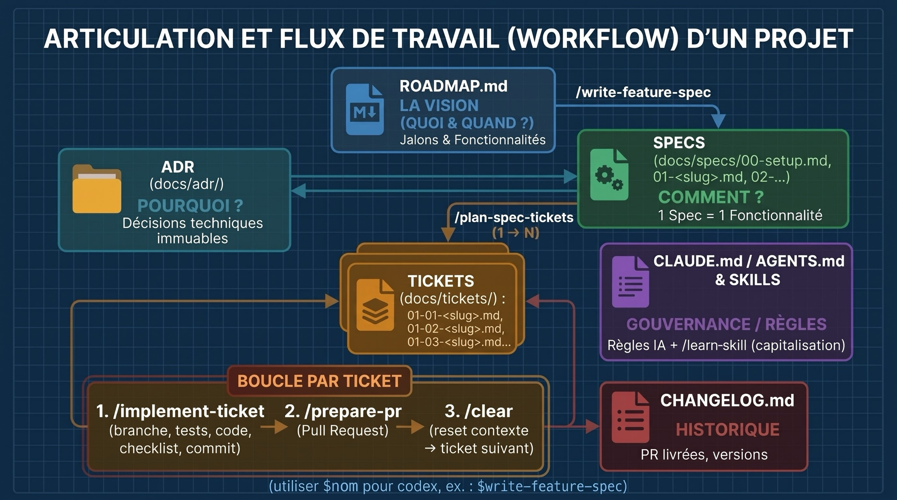

# AI Kit v3 — Workflow Claude Code & OpenAI Codex

[English](README.md) · **Français**

Kit réutilisable pour initialiser de nouveaux projets, restructurer des dépôts existants et cadrer le travail avec **Claude Code** et **OpenAI Codex**, avec les mêmes skills pour les deux, **en français ou en anglais**.

Pour une vue d'ensemble en schéma, le dictionnaire des termes et le fonctionnement des templates et des skills : voir [GUIDE.fr.md](GUIDE.fr.md).



## 1. Installation

Placez ce dossier où vous le souhaitez (par exemple `~/ai-kit/`, idéalement versionné dans votre dépôt Git personnel), puis lancez :

```bash
cd ~/ai-kit && ./install.sh
```

Le script peut être lancé depuis n'importe quel dossier. Ne déplacez pas le kit après l'installation (sinon, relancez `install.sh`).

### Ce que fait `install.sh`
- Lie `templates/` vers `~/.claude/templates`. Seule la skill `init-project` est globale : les skills du workflow sont copiées dans chaque projet, dans sa langue.
- Ajoute **un lien par skill globale du kit** dans `~/.claude/skills/` (Claude) et `~/.agents/skills/` (Codex), et retire les liens morts vers le kit (skill supprimée ou renommée). Ces deux dossiers restent les vôtres : vos propres skills, et celles que Claude synchronise depuis claude.ai, ne sont jamais déplacées.
- Avant de créer un lien, déplace tout dossier ou fichier existant au même endroit dans `~/.ai-kit-backup/<date>/`, hors des dossiers de skills (une sauvegarde laissée dans `~/.claude/skills/` serait chargée comme une skill en double).
- Rend les scripts exécutables (un zip peut perdre les droits).
- Si le kit est un dépôt Git : active son `pre-commit` (`core.hooksPath = .githooks`). Il bloque un commit si une skill n'est pas conforme ou si `templates/fr` et `templates/en` ne contiennent pas les mêmes fichiers, et avertit si un fichier dépasse son budget de lignes.

À relancer après l'ajout manuel d'une skill globale dans le kit. `learn-skill` crée le lien Codex lui-même.

### Désinstaller
`./install.sh --uninstall` retire les liens vers le kit (`~/.claude/templates`, et les liens vers les skills du kit dans `~/.claude/skills/` et `~/.agents/skills/`), propose de remettre chaque sauvegarde de `~/.ai-kit-backup/` une par une, et désactive le `pre-commit` du kit. Il ne supprime que des liens qui pointent vers ce kit ; le dossier du kit et les projets déjà initialisés ne sont pas touchés.

### Limites connues
- Les règles `deny` de `settings.json` (Claude) et `forbidden` de `.codex/rules/default.rules` (Codex) sont un garde-fou, pas une sécurité : une commande formulée autrement peut passer (ex. `git push origin main --force`, option à la fin).
- Les deux listes de commandes interdites sont séparées : **toute interdiction ajoutée d'un côté doit être ajoutée de l'autre**.
- **`.env`** : côté Claude, lecture et modification bloquées par `settings.json` (`.env`, `.env.local`, `.env.development`, `.env.production`, `.env.test`, à la racine du projet et dans tous ses sous-dossiers ; `.env.example` reste accessible). Ces règles s'appliquent aussi aux commandes que Claude reconnaît (`cat`, `head`, `tail`…). Côté Codex, les règles bloquent `cat`, `head`, `tail`, `less`, `more` et `bat` sur ces fichiers à la racine (`.env` ou `./.env`), mais ni ceux des sous-dossiers ni sa lecture de fichiers native : l'interdiction est donc aussi écrite dans `AGENTS.md`. Un refus s'affiche dans la session, et l'agent doit vous le signaler.
- **Conteneurs** : `init-project` repère `Dockerfile`, les fichiers Compose et `.devcontainer/`, et demande toujours si le projet utilise des conteneurs et où tournent les tests et le lint. Les commandes sont alors écrites telles qu'on les lance vraiment (ex. `docker compose exec api npm test`). Les deux agents ont l'interdiction de lancer `docker system prune`, `docker volume rm`/`prune` et `docker compose down -v`/`--volumes`, qui effacent des données ; une option placée avant `-v` passe quand même.
- **Budgets de lignes** (avertissement, sans blocage) : `CLAUDE.tpl.md` ≤ 100 et `AGENTS.tpl.md` ≤ 45 (vérifiés au commit dans le kit), chaque `SKILL.md` ≤ 80, et le `CLAUDE.md` d'un projet ≤ 150 (vérifié au début de chaque session ; rien ne s'affiche s'il est dans la limite).
- **Skills copiées** : une amélioration des skills du kit n'atteint pas les projets déjà initialisés. Il faut recopier les skills concernées dans ces projets.
- Les règles Codex sont expérimentales et ne s'appliquent qu'aux commandes lancées hors du bac à sable, dans un projet approuvé. Pour tester une commande : `codex execpolicy check --pretty --rules .codex/rules/default.rules -- rm -rf build`.
- Codex demande d'approuver une fois les hooks d'un projet (`/hooks` dans Codex). Un bug signalé empêche les hooks `SessionStart` de s'exécuter dans l'application Codex Desktop ; la CLI n'est pas concernée.
- `disable-model-invocation` est un réglage de Claude Code. Côté Codex, c'est la description de chaque skill (« seulement quand l'utilisateur le demande ») qui évite un déclenchement automatique.
- Extension VS Code de Claude Code : un bug signalé peut empêcher les skills **projet** (`.claude/skills/`) d'apparaître dans la liste `/`. Cela concerne les skills du workflow, qui sont copiées dans le projet. En cas de souci, lancez `claude` dans le terminal intégré.

---

## 2. Structure

```text
ai-kit/
├── README.md · README.fr.md     # usage (en / fr)
├── GUIDE.md · GUIDE.fr.md       # vue d'ensemble et dictionnaire (en / fr)
├── docs/assets/                 # images du workflow du README (restent dans le kit)
├── install.sh
├── .githooks/pre-commit         # vérifie skills, symétrie fr/en et budgets
├── skills/                      # skills globales (Claude + Codex)
│   └── init-project/            # seule skill globale du kit, bilingue
└── templates/
    ├── check-skill.sh           # vérification déterministe des skills (copiée dans chaque projet)
    ├── settings.tpl.json        # .claude/settings.json (permissions + hook SessionStart)
    ├── codex-hooks.tpl.json     # .codex/hooks.json (hook SessionStart)
    ├── codex-rules.tpl.rules    # .codex/rules/default.rules (commandes interdites)
    ├── pre-commit.tpl.sh        # .githooks/pre-commit du projet
    ├── en/                      # CLAUDE, AGENTS, ROADMAP, BACKLOG, CHANGELOG, TESTING, SPEC, TICKET, ADR, SKILL
    │   └── skills/              # write-feature-spec, plan-spec-tickets, implement-ticket, prepare-pr, learn-skill
    └── fr/                      # mêmes fichiers, en français
        └── skills/
```

---

## 3. Appeler une skill

| Claude Code | Codex | Ce qu'elle fait | Disponible |
|-------------|-------|-----------------|------------|
| `/init-project` | `$init-project` | Prépare le projet (questions, puis fichiers et skills) | partout (globale) |
| `/write-feature-spec authentification` | `$write-feature-spec authentification` | Écrit la spec d'une fonctionnalité dans `docs/specs/` | dans un projet initialisé |
| `/plan-spec-tickets docs/specs/01-authentification.md` | `$plan-spec-tickets docs/specs/01-authentification.md` | Découpe une spec validée en tickets dans `docs/tickets/` | dans un projet initialisé |
| `/implement-ticket docs/tickets/01-01-login-endpoint.md` | `$implement-ticket docs/tickets/01-01-login-endpoint.md` | Réalise un ticket : branche, tests, code, vérifications, commit | dans un projet initialisé |
| `/prepare-pr` | `$prepare-pr` | Audite la branche et rédige la description de la PR | dans un projet initialisé |
| `/learn-skill` | `$learn-skill` | Transforme une procédure répétée en nouvelle skill | dans un projet initialisé |

Les noms suivent la règle **verbe + objet** et se lisent dans l'ordre : une fonctionnalité reçoit une spec, la spec est découpée en tickets, chaque ticket est réalisé, puis sa PR est préparée.

Taper `/` (Claude Code) ou `$` (Codex) affiche la liste avec les descriptions, sans consommer de tokens.

---

## 4. Cycle de vie d'un projet

### Démarrer ou convertir un projet
Dans le dossier du projet (vide ou existant), lancez `claude` ou `codex`, puis `init-project`.
L'agent demande d'abord la **langue du projet** (`fr` / `en`) : tous les fichiers du projet, skills comprises, sont créés dans cette langue. Il demande ensuite la **langue des réponses** (par défaut, la même) : c'est celle des réponses et des comptes rendus, enregistrée dans `CLAUDE.md` pour toutes les sessions. Il analyse le dépôt (tests et hooks Git existants compris), pose ses questions par blocs de 3-4 (objectif, cibles, hors périmètre, commandes dev / lint / build, tests), puis génère :
- `CLAUDE.md` (règles, < 150 lignes ; commandes dev, lint et build) et `AGENTS.md` (pour Codex : renvoi vers `CLAUDE.md`, interdiction de lire `.env` et obligation de signaler une commande refusée)
- `ROADMAP.md`, `BACKLOG.md`, `CHANGELOG.md`
- `docs/TESTING.md` (outil, emplacement, nommage, commandes de test, format de preuve). Son statut vaut « Existant », « Mis en place le … » ou « Non installé » : dans ce dernier cas, `implement-ticket` s'arrête et propose d'abord le ticket de mise en place de l'outil.
- **Les 5 skills du workflow** dans `.claude/skills/` (dans la langue choisie), leurs liens Codex dans `.agents/skills/`, et le script `check-skill.sh` ; elles sont validées dès la copie
- `.claude/settings.json` et `.codex/hooks.json` (hooks de vérification des skills ; permissions côté Claude)
- `.codex/rules/default.rules` (commandes interdites côté Codex)
- `.githooks/pre-commit` (si aucun hook Git n'existait)
- `docs/specs/`, `docs/adr/`, `docs/tickets/`, `docs/drafts/`
- `.claude/settings.local.json` ajouté au `.gitignore` (vos autorisations personnelles ne sont pas commitées)

Aucun fichier existant n'est écrasé, et aucun outil de test n'est installé sans votre accord. Un projet sans linter reçoit `aucun` (ou `none`) comme commande de lint, et la checklist l'accepte comme preuve.

### En rythme de croisière
1. **Brouillons (optionnel) :** notes brutes dans `docs/drafts/`.
2. **Spécifier une feature :** `write-feature-spec authentification` → `docs/specs/01-authentification.md`. Le socle technique (dépôt, DB, CI, `.env.example`) est toujours `docs/specs/00-setup.md` (`write-feature-spec setup`) ; les autres features sont numérotées à partir de `01`.
3. **Découper en tickets :** `plan-spec-tickets` → `docs/tickets/01-01-login-endpoint.md`, … (numéro de la spec, puis du ticket). Chaque ticket liste ses tests à écrire et doit laisser `main` fonctionnel.
4. **Exécuter un ticket :** `implement-ticket docs/tickets/01-01-login-endpoint.md`. L'agent crée la branche, écrit les tests puis le code, lance tests et lint, donne la checklist avec preuves et propose le commit (après votre accord). En fin de ticket, il écrit tout l'avancement sur le disque et rappelle de lancer `/clear` avant le ticket suivant : chaque ticket repart d'un contexte vide, ce qui évite de payer à chaque message l'historique des tickets précédents. Après le dernier ticket d'une spec, il propose de la passer en « Implémentée » et de cocher sa ligne dans `ROADMAP.md`.
5. **Préparer la Pull Request :** `prepare-pr` (audit du diff, tests, documentation, description de PR).

### Règles clés du `CLAUDE.md`
- Tous les `.md` du projet sont tenus à jour, mais chaque modification est **proposée puis écrite après accord**. Seule exception : l'ajout d'un report dans « Reporté / Incomplet » du `BACKLOG.md`, signalé dans « Reports : … ».
- Une branche par ticket (1 ticket = 1 branche = 1 PR), et chaque ticket laisse `main` fonctionnel.
- Une nouvelle règle générique n'est inscrite dans `CLAUDE.md` **que sur autorisation explicite**.
- `CLAUDE.md` est écrit en **style compact léger** (phrases courtes et complètes, sans remplissage) : environ 12 % de tokens en moins par session, à un niveau testé pour que les règles restent suivies. `learn-skill` écrit les nouvelles skills et règles dans ce style.
- La checklist exige une **preuve** pour chaque Pass vérifiable (commande de test + résultat, branche, fichiers modifiés). La commande de test est dans `docs/TESTING.md`, celle de lint dans `CLAUDE.md`.
- Compte rendu de fin de tour : ce qui a été fait, les fichiers modifiés, « Reports : … » (ou « aucun nouveau » / « none » selon la langue des réponses) et une seule question écrite. Jamais « fait » s'il manque une partie (« en partie » + ce qui manque). Un accord donné pour une suite d'actions vaut pour toute la suite.

---

## 5. Capitaliser sur les erreurs (`learn-skill`)

En fin de session, `learn-skill` propose une règle pour `CLAUDE.md` ou une skill, **dans la langue du projet**. Rien n'est écrit sans votre autorisation.

| Portée | Fichier | Lien Codex |
|--------|---------|------------|
| **Projet (par défaut)** | `.claude/skills/<nom>/SKILL.md` | `.agents/skills/<nom>` (lien relatif, versionné) |
| **Globale (sur demande)** | `<kit>/skills/<nom>/SKILL.md`, liée dans `~/.claude/skills/<nom>` | `~/.agents/skills/<nom>` |

- Le nom doit être libre : ni une skill du projet, ni une de vos skills perso, ni une skill du kit ou du workflow. Une skill globale portant le nom d'une skill du workflow l'écraserait dans tous vos projets ; le `pre-commit` du kit bloque ce cas.
- Une skill ne passe en globale que si elle ne cite rien de propre au projet. Sinon, l'agent bloque et montre ce qu'il a trouvé.
- Après vérification, l'agent propose le commit : dans le projet (la skill part avec la PR en cours) ou dans le dépôt du kit pour une globale (`git -C <kit> …`), suivi d'un push si le kit a un remote. Chaque commit et push attend votre accord.
- Toute mention propre à un agent donne l'équivalent de l'autre (`/nom` ↔ `$nom`, `.claude/skills` ↔ `.agents/skills`…).
- Un appel de skill s'écrit toujours entre backticks (`` `/nom` `` et `` `$nom` ``) : un `/nom` sans backticks est lu comme un chemin de dossier et n'est pas contrôlé.

---

## 6. Vérification des skills (`check-skill.sh`)

Un script contrôle chaque skill, sans passer par le modèle : frontmatter (`name` = nom du dossier, `description`), parité Claude/Codex, lien Codex, budget de lignes. Dans un projet, il est copié dans `.claude/skills/learn-skill/scripts/` ; dans le kit, il est dans `templates/`.

```bash
CHECK=.claude/skills/learn-skill/scripts/check-skill.sh
$CHECK check    .claude/skills --agents .agents/skills          # toutes les skills
$CHECK check    .claude/skills --changed --agents .agents/skills # nouvelles ou modifiées seulement
$CHECK validate .claude/skills <nom> --agents .agents/skills     # valide et enregistre l'empreinte
$CHECK budget   CLAUDE.md 150                                     # avertit si le fichier dépasse 150 lignes
```

- `check` et `budget` ne modifient aucun fichier ; seul `validate` écrit l'empreinte.
- Les empreintes des skills validées sont dans `.claude/skills/.validated` pour un projet et dans `skills/.validated` pour le kit (à versionner).
- **Début de session** (Claude et Codex) : le hook lance `check --changed` et `budget` sur le `CLAUDE.md`. S'il n'y a rien à signaler, il n'affiche rien et ne coûte aucun token. Hors dépôt Git (avant `git init`), le hook Codex contrôle le dossier courant. Si le script est absent, le hook ne fait rien.
- **Commit** : le `pre-commit` bloque si une skill du projet n'est pas conforme. Comme le script est copié dans le projet, ces contrôles fonctionnent aussi sur un clone où le kit n'est pas installé.
