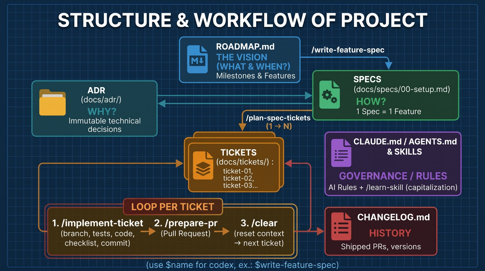

# AI Kit v3 — Claude Code & OpenAI Codex workflow

**English** · [Français](README.fr.md)

Reusable kit to bootstrap new projects, restructure existing repositories and frame the work with **Claude Code** and **OpenAI Codex**, with the same skills for both, **in English or French**.

For a diagram overview, the glossary and how templates and skills work: see [GUIDE.md](GUIDE.md).



## 1. Installation

Put this folder wherever you like (e.g. `~/ai-kit/`, ideally versioned in your personal Git repository), then run:

```bash
cd ~/ai-kit && ./install.sh
```

The script can be run from any folder. Do not move the kit after installing it (otherwise, run `install.sh` again).

### What `install.sh` does
- Links `templates/` into `~/.claude/templates`. Only the `init-project` skill is global: the workflow skills are copied into each project, in its language.
- Adds **one link per global skill of the kit** in `~/.claude/skills/` (Claude) and `~/.agents/skills/` (Codex), and removes dead links to the kit (deleted or renamed skill). These two folders stay yours: your own skills, and those Claude syncs from claude.ai, are never moved.
- Before creating a link, moves any existing folder or file at the same place into `~/.ai-kit-backup/<date>/`, outside the skill folders (a backup left in `~/.claude/skills/` would be loaded as a duplicate skill).
- Makes the scripts executable (a zip can lose permissions).
- If the kit is a Git repository: enables its `pre-commit` (`core.hooksPath = .githooks`). It blocks a commit if a skill is not conformant or if `templates/en` and `templates/fr` do not hold the same files, and warns when a file exceeds its line budget.

Run it again after manually adding a global skill to the kit. `learn-skill` creates the Codex link itself.

### Uninstalling
`./install.sh --uninstall` removes the links to the kit (`~/.claude/templates`, and the links to the kit's skills in `~/.claude/skills/` and `~/.agents/skills/`), offers to restore each backup from `~/.ai-kit-backup/` one by one, and disables the kit's `pre-commit`. It only removes links pointing to this kit; the kit folder and already initialized projects are left untouched.

### Known limits
- The `deny` rules of `settings.json` (Claude) and the `forbidden` rules of `.codex/rules/default.rules` (Codex) are a guardrail, not security: a command phrased differently can get through (e.g. `git push origin main --force`, option at the end).
- The two lists of forbidden commands are separate: **any ban added on one side must be added on the other**.
- **`.env`**: on the Claude side, reading and editing are blocked by `settings.json` (`.env`, `.env.local`, `.env.development`, `.env.production`, `.env.test`, at the project root and in every subfolder; `.env.example` stays accessible). These rules also apply to the commands Claude recognizes (`cat`, `head`, `tail`…). On the Codex side, the rules block `cat`, `head`, `tail`, `less`, `more` and `bat` on these files at the root (`.env` or `./.env`), but neither those in subfolders nor its native file reading: the ban is therefore also written in `AGENTS.md`. A refusal shows in the session, and the agent must report it to you.
- **Containers**: `init-project` detects `Dockerfile`, Compose files and `.devcontainer/`, and always asks whether the project uses containers and where tests and lint run. Commands are then written as they are really run (e.g. `docker compose exec api npm test`). Both agents are forbidden `docker system prune`, `docker volume rm`/`prune` and `docker compose down -v`/`--volumes`, which delete data; an option placed before `-v` still gets through.
- **Line budgets** (warning, never blocking): `CLAUDE.tpl.md` ≤ 100 and `AGENTS.tpl.md` ≤ 45 (checked at commit time in the kit), each `SKILL.md` ≤ 80, and a project's `CLAUDE.md` ≤ 150 (checked at the start of each session; nothing shows when within the limit).
- **Copied skills**: an improvement of the kit's skills does not reach already initialized projects. The affected skills must be copied again into those projects.
- Codex rules are experimental and only apply to commands run outside the sandbox, in a trusted project. To test a command: `codex execpolicy check --pretty --rules .codex/rules/default.rules -- rm -rf build`.
- Codex asks to approve a project's hooks once (`/hooks` in Codex). A reported bug prevents `SessionStart` hooks from running in the Codex Desktop app; the CLI is not affected.
- `disable-model-invocation` is a Claude Code setting. On the Codex side, each skill's description ("use only when the user explicitly asks") is what prevents automatic triggering.
- Claude Code VS Code extension: a reported bug can keep **project** skills (`.claude/skills/`) out of the `/` list. This affects the workflow skills, which are copied into the project. If it happens, run `claude` in the integrated terminal.

---

## 2. Structure

```text
ai-kit/
├── README.md · README.fr.md     # usage (en / fr)
├── GUIDE.md · GUIDE.fr.md       # overview and glossary (en / fr)
├── docs/assets/                 # workflow images of the README (stay in the kit)
├── install.sh
├── .githooks/pre-commit         # checks skills, en/fr symmetry and budgets
├── skills/                      # global skills (Claude + Codex)
│   └── init-project/            # the kit's only global skill, bilingual
└── templates/
    ├── check-skill.sh           # deterministic skill checks (copied into each project)
    ├── settings.tpl.json        # .claude/settings.json (permissions + SessionStart hook)
    ├── codex-hooks.tpl.json     # .codex/hooks.json (SessionStart hook)
    ├── codex-rules.tpl.rules    # .codex/rules/default.rules (forbidden commands)
    ├── pre-commit.tpl.sh        # the project's .githooks/pre-commit
    ├── en/                      # CLAUDE, AGENTS, ROADMAP, BACKLOG, CHANGELOG, TESTING, SPEC, TICKET, ADR, SKILL
    │   └── skills/              # write-feature-spec, plan-spec-tickets, implement-ticket, prepare-pr, learn-skill
    └── fr/                      # same files, in French
        └── skills/
```

---

## 3. Calling a skill

| Claude Code | Codex | What it does | Available |
|-------------|-------|--------------|-----------|
| `/init-project` | `$init-project` | Prepares the project (questions, then files and skills) | everywhere (global) |
| `/write-feature-spec authentication` | `$write-feature-spec authentication` | Writes the spec of a feature in `docs/specs/` | in an initialized project |
| `/plan-spec-tickets docs/specs/01-authentication.md` | `$plan-spec-tickets docs/specs/01-authentication.md` | Splits a validated spec into tickets in `docs/tickets/` | in an initialized project |
| `/implement-ticket docs/tickets/01-01-login-endpoint.md` | `$implement-ticket docs/tickets/01-01-login-endpoint.md` | Implements one ticket: branch, tests, code, checks, commit | in an initialized project |
| `/prepare-pr` | `$prepare-pr` | Audits the branch and writes the PR description | in an initialized project |
| `/learn-skill` | `$learn-skill` | Turns a repeated procedure into a new skill | in an initialized project |

Names follow the **verb + object** rule and read in order: a feature gets a spec, the spec gets tickets, each ticket is implemented, then its PR is prepared.

Typing `/` (Claude Code) or `$` (Codex) shows the list with descriptions, without using tokens.

---

## 4. Project lifecycle

### Starting or converting a project
In the project folder (empty or existing), run `claude` or `codex`, then `init-project`.
The agent first asks for the **project language** (`fr` / `en`): every project file, skills included, is created in that language. It then asks for the **reply language** (same by default): the language of replies and reports, recorded in `CLAUDE.md` for every session. It analyzes the repository (existing tests and Git hooks included), asks its questions in blocks of 3-4 (goal, target users, out of scope, dev / lint / build commands, tests), then generates:
- `CLAUDE.md` (rules, < 150 lines; dev, lint and build commands) and `AGENTS.md` (for Codex: pointer to `CLAUDE.md`, ban on reading `.env` and duty to report a refused command)
- `ROADMAP.md`, `BACKLOG.md`, `CHANGELOG.md`
- `docs/TESTING.md` (tool, location, naming, test commands, evidence format). Its status is "Existing", "Set up on …" or "Not installed": in the last case, `implement-ticket` stops and first proposes the ticket that sets up the tool.
- **The 5 workflow skills** in `.claude/skills/` (in the chosen language), their Codex links in `.agents/skills/`, and the `check-skill.sh` script; they are validated right after the copy
- `.claude/settings.json` and `.codex/hooks.json` (skill-check hooks; permissions on the Claude side)
- `.codex/rules/default.rules` (forbidden commands on the Codex side)
- `.githooks/pre-commit` (if no Git hook existed)
- `docs/specs/`, `docs/adr/`, `docs/tickets/`, `docs/drafts/`
- `.claude/settings.local.json` added to `.gitignore` (your personal permissions are never committed)

No existing file is overwritten, and no test tool is installed without your approval. A project with no linter gets `none` (or `aucun`) as lint command, and the checklist accepts it as evidence.

### Day-to-day
1. **Drafts (optional):** raw notes in `docs/drafts/`.
2. **Specify a feature:** `write-feature-spec authentication` → `docs/specs/01-authentication.md`. The technical base (repo, DB, CI, `.env.example`) is always `docs/specs/00-setup.md` (`write-feature-spec setup`); other features are numbered from `01`.
3. **Split into tickets:** `plan-spec-tickets` → `docs/tickets/01-01-login-endpoint.md`, … (spec number, then ticket number). Each ticket lists its tests to write and must leave `main` working.
4. **Run a ticket:** `implement-ticket docs/tickets/01-01-login-endpoint.md`. The agent creates the branch, writes the tests then the code, runs tests and lint, gives the checklist with evidence and proposes the commit (after your approval). At the end of the ticket, it writes all progress to disk and reminds you to run `/clear` before the next ticket: each ticket starts from an empty context, which avoids paying for the previous tickets' history on every message. After a spec's last ticket, it proposes to set it to "Implemented" and to tick its line in `ROADMAP.md`.
5. **Prepare the Pull Request:** `prepare-pr` (diff audit, tests, documentation, PR description).

### Key rules of `CLAUDE.md`
- Every project `.md` file is kept up to date, but each change is **proposed, then written after approval**. Only exception: adding a postponed item under "Postponed / Incomplete" in `BACKLOG.md`, reported in "Reports : …".
- One branch per ticket (1 ticket = 1 branch = 1 PR), and each ticket leaves `main` working.
- A new generic rule is written in `CLAUDE.md` **only with explicit authorization**.
- The checklist requires **evidence** for each verifiable Pass (test command + result, branch, files changed). The test command is in `docs/TESTING.md`, the lint command in `CLAUDE.md`.
- End-of-turn report: what was done, the files changed, "Reports : …" (or "none" / « aucun nouveau », depending on the reply language) and a single written question. Never "done" if a part is missing ("partly done" + what is missing). An approval given for a sequence of actions covers the whole sequence.

---

## 5. Capturing mistakes (`learn-skill`)

At the end of a session, `learn-skill` proposes a rule for `CLAUDE.md` or a skill, **in the project language**. Nothing is written without your authorization.

| Scope | File | Codex link |
|-------|------|------------|
| **Project (default)** | `.claude/skills/<name>/SKILL.md` | `.agents/skills/<name>` (relative link, versioned) |
| **Global (on request)** | `<kit>/skills/<name>/SKILL.md`, linked in `~/.claude/skills/<name>` | `~/.agents/skills/<name>` |

- The name must be free: not a project skill, not one of your personal skills, not a kit or workflow skill. A global skill named like a workflow skill would override it in all your projects; the kit's `pre-commit` blocks this case.
- A skill only becomes global if it cites nothing specific to the project. Otherwise, the agent stops and shows what it found.
- After the check, the agent proposes the commit: in the project (the skill ships with the current PR) or in the kit repository for a global one (`git -C <kit> …`), followed by a push if the kit has a remote. Each commit and push waits for your approval.
- Any mention specific to one agent gives the other's equivalent (`/name` ↔ `$name`, `.claude/skills` ↔ `.agents/skills`…).
- A skill call is always written between backticks (`` `/name` `` and `` `$name` ``): a `/name` without backticks is read as a folder path and is not checked.

---

## 6. Skill checks (`check-skill.sh`)

A script checks each skill without going through the model: frontmatter (`name` = folder name, `description`), Claude/Codex parity, Codex link, line budget. In a project, it is copied into `.claude/skills/learn-skill/scripts/`; in the kit, it lives in `templates/`.

```bash
CHECK=.claude/skills/learn-skill/scripts/check-skill.sh
$CHECK check    .claude/skills --agents .agents/skills          # all skills
$CHECK check    .claude/skills --changed --agents .agents/skills # new or modified only
$CHECK validate .claude/skills <name> --agents .agents/skills    # validates and records the fingerprint
$CHECK budget   CLAUDE.md 150                                     # warns if the file exceeds 150 lines
```

- `check` and `budget` change no file; only `validate` writes the fingerprint.
- Fingerprints of validated skills are stored in `.claude/skills/.validated` for a project and in `skills/.validated` for the kit (to be versioned).
- **Session start** (Claude and Codex): the hook runs `check --changed` and `budget` on `CLAUDE.md`. When there is nothing to report, it prints nothing and costs no tokens. Outside a Git repository (before `git init`), the Codex hook checks the current folder. If the script is missing, the hook does nothing.
- **Commit**: the `pre-commit` blocks if a project skill is not conformant. Since the script is copied into the project, these checks also work on a clone where the kit is not installed.
